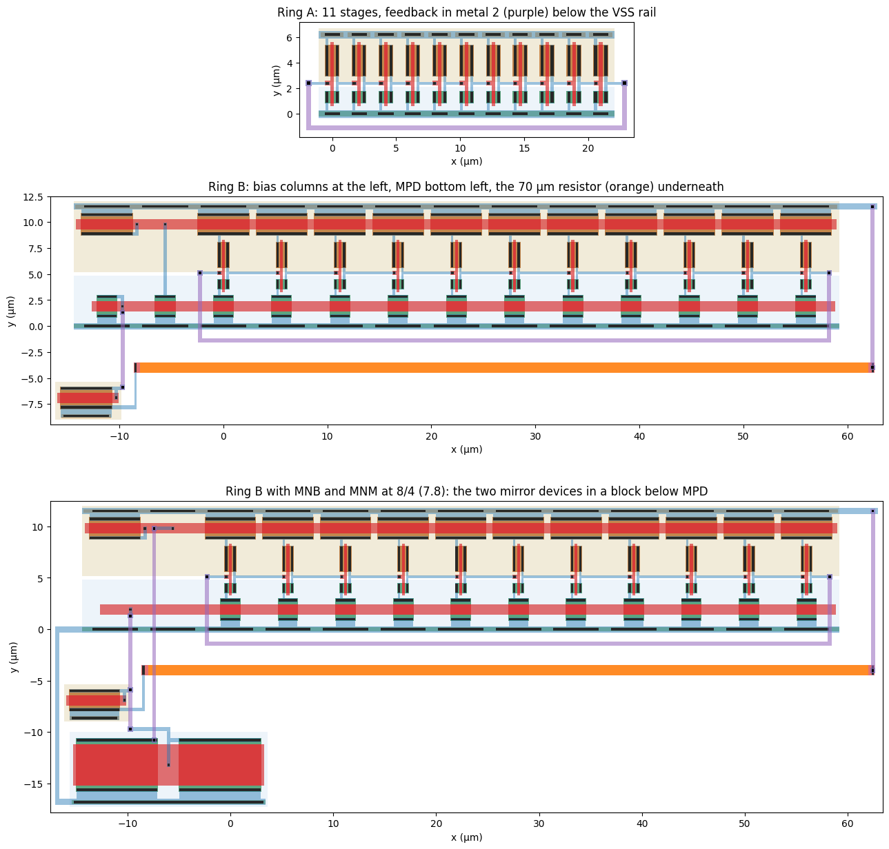
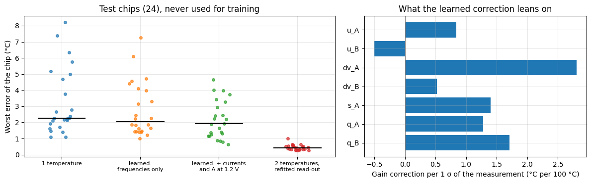
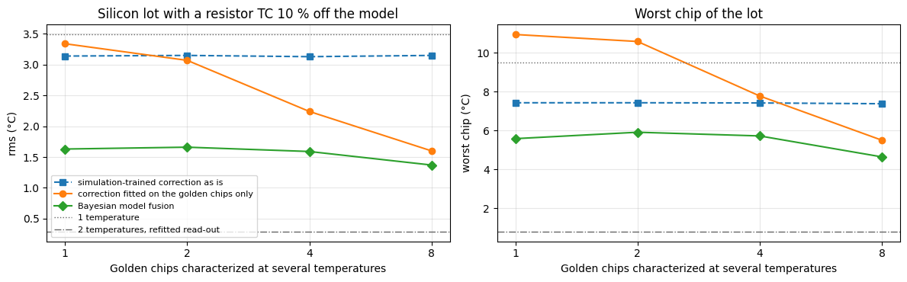
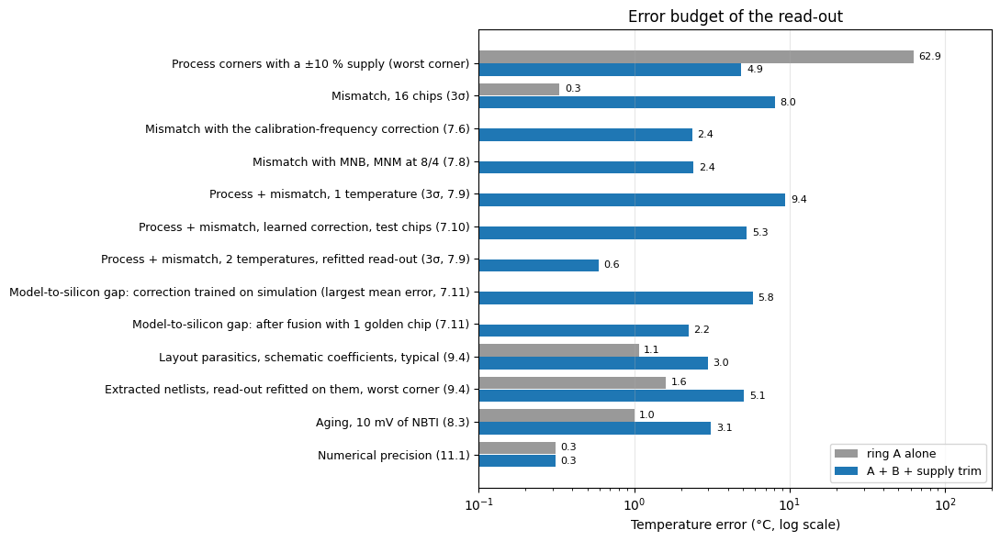

# Separating temperature from supply with two ring oscillators in GF180MCU

IEEE SSCS Code-a-Chip submission for ISSCC 2027.

Author: Orlando Arturo Palma León, Universidad de Sonora (México).

## Summary

A ring oscillator reads temperature, but its frequency depends just as much on the supply. This notebook pairs a plain CMOS ring (A) with a resistor-biased current-starved ring (B) in the open GF180MCU PDK, so that the two frequencies separate temperature from supply with one calibration temperature. It covers five process corners, −40 to 125 °C and a ±10 % supply. A 16-chip mismatch Monte Carlo traces the remaining spread to one shared mirror device, and a second Monte Carlo verifies the fix; the corners show what it costs. A 48-chip Monte Carlo with process and mismatch together compares one and two calibration temperatures and tests a machine-learned correction on 24 chips it was not trained on: with three extra measurements at the single calibration temperature, it halves the one-temperature error. On an emulated lot whose resistor departs from the model, Bayesian model fusion adapts that simulation-trained correction with a single measured chip. Both rings, and ring B with the larger mirror, are laid out as code in magic, pass DRC, LVS and the PDK's KLayout sign-off deck, and are simulated after extraction across the five corners. The notebook closes with an aging study, an error budget and a comparison with published sensors.

## Results at a glance

| | Ring A alone | Rings A + B with supply trim |
|---|---|---|
| Inaccuracy, 5 corners, ±10 % supply (one-point calibration) | 45–63 °C | ≤ 2 °C in four corners, 4.9 °C in ff |
| Residual supply sensitivity | 126–166 °C/V | ≤ 3.5 °C/V |
| Mismatch, 16 Monte Carlo chips (3σ) | 0.3 °C | 8.0 °C; 2.4 °C with a 16× larger mirror reference |
| Process + mismatch, 24 unseen Monte Carlo chips (3σ) | — | 10.0 °C with 1 calibration temperature; 5.3 °C with the learned correction; 0.7 °C with 2 temperatures |
| Model-to-silicon gap: lot with a resistor TC 10 % off the model (rms) | — | 3.1 °C with the simulation-trained correction; 1.6 °C after Bayesian model fusion with 1 measured chip; 0.3 °C with 2 temperatures |
| Layout parasitics, schematic read-out | 1.1 °C | 3.0 °C |
| Extracted netlists, 5 corners, read-out refitted on them | ≤ 1.6 °C at 3.3 V | ≤ 2.2 °C in four corners, 5.1 °C in ff |
| Aging, 10 mV of NBTI | 1.0 °C | 3.1 °C |
| Area (layout clean under magic DRC, KLayout sign-off DRC and LVS) | 202 µm² | 202 + 1660 µm² |
| Power, continuous | 1.2 mW | 1.4 mW |
| Energy per conversion at 0.1 °C quantization (estimate, rings only) | 5.6 nJ | 21 nJ |

## Run it

Open `ro_pvt_gf180.ipynb` in Google Colab (button above) and choose *Runtime → Run all*. The first cell builds ngspice 45.2 from source and fetches the GF180MCU device models at a pinned commit; the layout section installs magic, netgen, KLayout and the GF180MCU technology files with micromamba. The PVT grids (105 simulations per ring), the mismatch Monte Carlo (288 simulations), the mirror fix (170 simulations, plus 84 across the corners), the process + mismatch Monte Carlo (1008 simulations, plus 504 for the emulated silicon lot) and the extracted netlists across the corners (210 simulations) take most of the run and are cached as CSV files for the rest of the session. A complete run on a free Colab runtime (2 CPU cores) takes about 7 hours; keep the browser tab open while it runs. The notebook in this folder already contains the outputs of a complete run.

To rerun every analysis without the long simulation sets, tick `USE_SAVED_SIMULATIONS` in the first cell (a checkbox in Colab, or set it to `True`). The notebook then loads the simulation results of that run from the `data` folder and finishes in under an hour; the layout flow and the shorter simulations still run.

To use an existing installation instead, set `NGSPICE` (path to the ngspice binary) and `GF180_MODELS` (folder holding `design.spice` and `sm141064.spice`) before running the first cell.

## Reusing the code

The notebook's parts are functions that take the design choices as arguments: `ro_netlist` and `csro_netlist` (stage count, device sizes, bias stack, resistor), `ring_a_layout` and `ring_b_layout` (layout as code in magic, followed by LVS, sign-off DRC and extraction), and the calibration analyses of sections 7.9 to 7.11, which read a table of per-chip measurements (the format of the CSV files in `data`) rather than the circuit, so they apply to any two-oscillator sensor. Rings of 7 and 15 stages with 50- to 100-square resistors, generated with the same code, pass magic DRC, LVS and the sign-off deck. The end of section 13 lists these functions.

## Files

- `ro_pvt_gf180.ipynb`: the notebook, with the outputs of a complete Colab run
- `layout.png`, `learned_calibration.png`, `model_fusion.png`, `error_budget.png`: four figures from that run, shown above
- `data/`: the results of the long simulation sets of that run, as CSV files, for `USE_SAVED_SIMULATIONS = True`
- `LICENSE`: Apache License 2.0

## Tools

- ngspice 45.2
- GF180MCU primitive device library `gf180mcu_fd_pr`, commit `5e4be8726e2ae8be099c4131f697a353d6457874`
- magic 8.3.464, netgen 1.5.272 and open_pdks `gf180mcuC` 1.0.471 (litex-hub conda packages, installed by the notebook with micromamba 2.3.0, for the layout, DRC, LVS and extraction)
- KLayout 0.28.17 (litex-hub) with Ruby 2.5 (anaconda channel), for the GF180MCU sign-off DRC deck of open_pdks
- schemdraw 0.23 (installed by the notebook with pip, for the schematics)

## Acknowledgements

Claude (Anthropic) assisted with the circuit analysis, the code, the literature search and the writing; every result comes from the simulations in the notebook, and its content is the author's responsibility.

## License

Apache License 2.0. See `LICENSE`.
